# 나랑 맞으면 [여기](https://github.com/Kor-sh/Kor-sh/issues/new)에 이슈로 넣으셈 한 일주일마다 봄 ㅋㅋㅋ 그니까 걍 거기에 sns(디코, 카톡, 텔레 중에서) 넣고 하면 내가 연락 줌

저는 한 번에 깊게 파기보다, 일단 찍어보고 바로 구현해보는 스타일의 개발자입니다.  
처음부터 완벽하게 설계하려고 하기보다는, 빠르게 무언가를 만들어보고, 실패를 보며 수정하고, 다시 만들어보는 방식에 더 익숙합니다.  
그래서 저는 “바이브 코더”라는 표현이 제일 잘 어울리는 편임.  
하지만 단순히 감에 의존해서 코드를 짜는 사람이 아니라, Python, TypeScript, JavaScript, Batch, HTML, C, C++, C#, Unity 같은 언어와 도구를 직접 다루고, 필요한 기능을 빠르게 구현해낼 수 있는 개발자입니다.

저는 디스코드 봇, 카카오톡 봇, AI 프로젝트, 폰트 제작, APK 제작, 웹사이트 제작, 모바일 위젯 제작, 마인크래프트 모드 개발 등등 다양한 프로젝트를 직접 만들어본 경험이 있습니다.  
특히 “뭐든 일단 만든다”는 접근이 제 강점입니다.  
단순히 따라하는 수준이 아니라, 필요한 기능을 직접 설계하고, 자동화하고, 시뮬레이션하고, 실제로 동작하는 형태로 만들어내는 걸 좋아합니다.

제가 만든 것들 중에는 단순한 자동화부터, 게임, AI, 시뮬레이션, 서버, 도구 제작까지 폭넓게 있습니다.  
예를 들어, 디스코드 봇을 통해 여러 자동 기능을 만들고, 카카오톡 오픈톡방과 디스코드 서버를 연결해주는 구조도 만들어본 적이 있습니다.  
또한, 어떤 프로그램의 인터넷 핑을 크게 만드는 프로그램, 로블록스 Lua로 무한의 계단 어쩌구 프로젝트도 제작해본 경험이 있습니다.  
그때는 AI 지식이 부족해서 그냥 ChatGPT와 대화하며 복붙하고, 필요한 부분을 붙여가며 만드는 방식으로 문제를 해결하던 시절도 있었어요.  
그 경험이 오히려 제게 “구현 중심 개발”의 감각을 키워주었습니다.

저는 마인크래프트를 2020년부터 꾸준히 해왔고, 지금도 관련 프로젝트와 창작을 이어가고 있습니다.  
특히 마인크래프트 모드 제작과 커스텀 서버 운영에 관심이 많고, 게임 내에서 실제로 동작하는 시스템을 직접 설계하는 과정 자체를 즐깁니다.  
또한 로블록스도 다뤄본 적이 있지만, 마인크래프트 쪽이 더 오래하고 더 깊게 다뤄온 분야입니다.  
그 과정에서 "재미있는 아이디어를 실제 기능으로 바꾸는 것"에 대한 감각이 생겼고, 지금도 그런 방식으로 프로젝트를 만들고 있습니다.

제 프로젝트 중 가장 기억에 남는 건 산업용 나무 모델(TreeIT)을 활용해 만든 50만개 규모의 나무 심기 로블록스 맵입니다.  
LOD를 넣는 등 그래픽적인 요소도 고려했지만, 그래도 렉이 심해서 3fps도 버거운 수준까지 가는 경우도 있었습니다.  
그때 느꼈던 건 단순히 “예쁜 걸 만드는 것”보다, 실제로 돌아가게 만들고, 성능을 맞추고, 최적화까지 고려해야 한다는 점이었습니다.  
그 경험은 이후 제가 여러 프로젝트를 만들 때 성능과 구현의 균형을 생각하게 만드는 계기가 되었습니다.

또한 저는 모바일 기기에 컴퓨터 키보드 넣기, 영상 자동 컷 편집, 마크 서버 열기, AI로 사진을 변형하면서 어떻게 변하나 시뮬레이션하는 작업도 해본 적이 있습니다.  
특히 딱 한 번 보조적으로 AI를 사용하던 수준이 아니라, AI를 실제 프로젝트에 적용해보는 경험을 좋아합니다.  
사진을 여러 번 변형하거나, 모델을 활용해 이미지를 처리하는 시도를 해봤고, 그 과정에서 AI를 “도구”로 쓰는 법과 “무언가를 직접 만들어내는 법”을 동시에 익혔습니다.
-# 하지만 너무 이상해지다 검정색이 됬지만요

C#으로 Unity와 AI를 결합해 드론 시뮬레이터를 만든 경험도 있습니다.  
이 프로젝트는 단순히 게임처럼 보여주는 수준이 아니라, AI가 논문을 참고하면서 실제로 동작하는 구조를 만들려는 시도였습니다.  
그 과정은 생각보다 순조로웠고 어떻게 에이전트를 배치해야 ai가 전에쓴 이상한 코드를 보고 또 이상한 코드를 안 쓰게 할지 알아냈습니다.

저는 프로젝트를 많이 만들고, 많이 해보는 사람입니다.  
그 결과 지금 제 컴퓨터에는 수십 개의 실험 프로젝트, 여러 AI 모델, 이미지 자료, 오래된 코드 파일들이 한데 섞여 있습니다.  
제가 자주 하는 말이 있는데, “정리하기 전에 만들고 싶은 게 너무 많다”는 거예요.  
그래서 지금은 파일 구조가 너무 엉망돼서, main/1.py, main/adsdef/1.py, main/1~50.py 같은 식으로 정리가 되지 않는 상황도 많습니다.  
하지만 그만큼 제 안에는 계속 떠오르는 아이디어들이 많고, 실험하고 싶은 것들이 많다는 뜻이기도 합니다.  
어떤 의미로는 그게 제 장점이기도 해요.  
“무언가를 만들고 싶다”는 의지가 강한 사람이기 때문입니다.

저는 단순히 어떤 언어를 많이 아는 사람보다, 어떤 문제를 어떻게 구현해내는지에 더 강한 관심이 있습니다.  
그래서 프로젝트를 할 때도 “이게 가능한지”, “어떻게 만들 수 있을지”, “실제로 작동하게 하려면 뭘 더 붙여야 하는지”를 중요하게 봅니다.  
이런 방식으로 접근하다 보니, 단순한 앱 제작이나 봇 제작뿐 아니라, 시뮬레이션, 자동화, 게임 시스템, 서버 구조, UI, 기능 조합 같은 영역에도 잘 적응하는 편입니다.

결국 제 개발 스타일은 이렇습니다:

- 한 번에 깊게 파기보다, 직접 만들어보고 빠르게 실험한다
- 아이디어가 있으면 구현해보고 검증한다
- 문서보다 실제 동작이 우선이다
- 결과물이 없으면 완성했다고 보기 어렵다
- 만들고 보완하는 과정을 즐긴다
- 실패해도 더 나은 구조로 바꾸는 데 익숙하다

저는 단순히 코드를 잘 짜는 사람이라기보다, “무언가를 만들어내는 사람”입니다.  
그 과정에서 재미를 느끼고, 성취감을 얻고, 결과물을 통해 다시 성장합니다.  
그래서 저는 지금도 새로운 프로젝트를 계속 만들고, 자주 실험하고, 결국에는 직접 동작하는 결과물로 남기는 방식을 좋아합니다.

간단히 말하면, 저는 “바이브로 시작해도 결국 구현까지 가는 개발자”입니다.  
그리고 그 구현이 진짜 제 강점입니다.

---

# 한 줄 요약

“무언가를 만들고 싶으면 일단 돌려보고, 실패를 보며 개선하고, 결국 실제로 동작하는 결과물을 만드는 개발자.”인데 걍 쓸때 없는거 만드는 건 맞음 ㅋㅋ ☠️☠️
